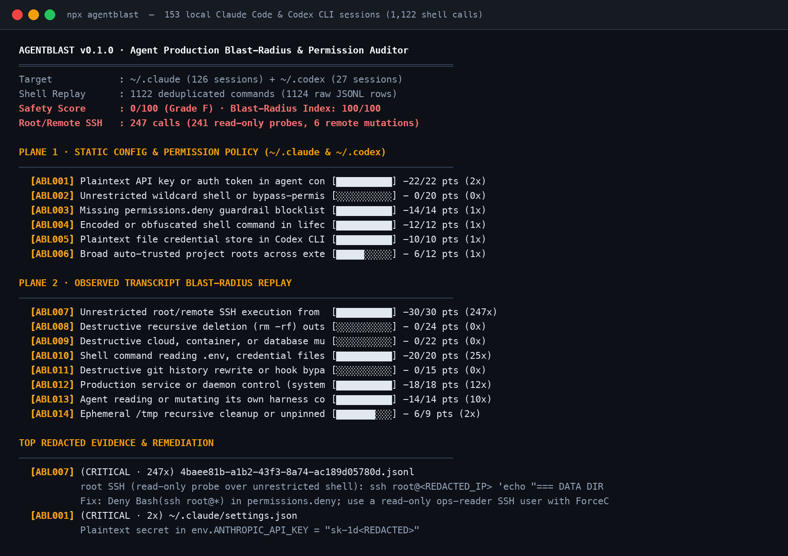

<p align="center">
  
</p>

<h1 align="center">agentblast</h1>

<p align="center">
  <strong>Static config &amp; transcript-replay blast-radius auditor for Claude Code and Codex CLI</strong>
</p>

<p align="center">
  <a href="https://www.npmjs.com/package/agentblast"></a>
  <a href="./LICENSE"></a>
</p>

<p align="center">
  
</p>

## Why this exists

In a thread on `r/devops` today (*"How do I make colleagues aware of the risks of giving an LLM agent root access to production?"*), an ops engineer described teammates giving their coding agent root SSH access to production servers just so the agent could inspect logs and check service status. Logging what the agent runs does not limit what the connection allows: if the agent holds an unrestricted `ssh root@host` shell, there is zero boundary between `systemctl is-active` and `systemctl stop` or `rm -rf`.

When I ran `agentblast` against my own workstation (`126` Claude Code sessions in `~/.claude/projects` and `27` Codex CLI sessions in `~/.codex/sessions`, `1,122` deduplicated shell commands), it surfaced:

- **`247` `ssh root@...` calls** (`241` read-only log/status probes and `6` remote mutations) executed over an unrestricted root SSH channel.
- **`2` plaintext API keys** (`ANTHROPIC_API_KEY` and `ANTHROPIC_AUTH_TOKEN`) sitting in `~/.claude/settings.json` alongside `0` `permissions.deny` rules.
- **`41` auto-trusted project roots** (`trust_level = "trusted"`) and `cli_auth_credentials_store = "file"` in `~/.codex/config.toml`.
- **`25` shell commands reading `.env` or service drop-in credentials** and **`12` `systemctl`/`docker` daemon commands**.

My first regex pass also had two embarrassing bugs: it treated `rm -rf /tmp/quantiti-head` and `cd /tmp && rm -rf obskill` with the same `CRITICAL` severity as `rm -rf ./src`, and it printed raw production IPv4 addresses and key prefixes in the evidence snippet. `agentblast` now separates ephemeral `/tmp` cleanups (`ABL014`, `LOW`) from non-`/tmp` recursive deletions (`ABL008`, `CRITICAL`) and automatically redacts public IPv4 addresses (`<REDACTED_IP>`), secret tokens (`sk-<REDACTED>`), and Base64 hook payloads (`<REDACTED_B64>`).

## Quickstart

```bash
# Audit your local ~/.claude and ~/.codex configs + session transcripts
npx agentblast

# Run on the bundled multi-session demo fixture
npx agentblast --demo

# Emit a drop-in least-privilege .claude/settings.json permissions block
npx agentblast --emit-policy

# Machine-readable JSON output or CI gate
npx agentblast --json
npx agentblast --fail-under 80
```

## 14 Rules Across 2 Audit Planes (`ABL001` to `ABL014`)

### Plane 1: Static Config & Permission Policy (`~/.claude/settings.json`, `~/.codex/config.toml`)
| Rule | Severity | Cap | What it checks |
| :--- | :--- | :--- | :--- |
| `ABL001` | `CRITICAL` | 22 | Plaintext API keys or auth tokens in `settings.json` `env` block |
| `ABL002` | `CRITICAL` | 20 | Unrestricted `Bash(*)`, `dangerouslySkipPermissions`, or `approval_policy = "never"` |
| `ABL003` | `HIGH` | 14 | Missing `permissions.deny` guardrail blocklist in `~/.claude/settings.json` |
| `ABL004` | `HIGH` | 12 | Obfuscated or `-EncodedCommand` / `base64` shell payloads inside lifecycle hooks |
| `ABL005` | `MEDIUM` | 10 | `cli_auth_credentials_store = "file"` in `~/.codex/config.toml` instead of OS keychain |
| `ABL006` | `MEDIUM` | 12 | 5+ auto-trusted project roots (`trust_level = "trusted"`) across volumes |

### Plane 2: Observed Transcript Blast-Radius Replay (`~/.claude/projects/**/*.jsonl`, `~/.codex/sessions/**/*.jsonl`)
| Rule | Severity | Cap | What it checks |
| :--- | :--- | :--- | :--- |
| `ABL007` | `CRITICAL` | 30 | Unrestricted `ssh root@` / remote `ssh`/`scp`/`rsync` execution (splits read-only probes vs remote mutations) |
| `ABL008` | `CRITICAL` | 24 | Non-ephemeral `rm -rf` recursive deletion outside `/tmp` or `$TMPDIR` |
| `ABL009` | `CRITICAL` | 22 | Destructive cloud, K8s, Terraform, or database mutation (`terraform destroy`, `kubectl delete`, `DROP TABLE`) |
| `ABL010` | `HIGH` | 20 | Shell commands reading `.env`, `~/.npmrc`, `~/.ssh/`, `~/.aws/credentials`, or `printenv` |
| `ABL011` | `HIGH` | 15 | Destructive git history rewrite (`git push --force`, `git reset --hard`, `git clean -fd`) or `--no-verify` |
| `ABL012` | `HIGH` | 18 | Production service or container daemon control (`systemctl`, `pm2`, `nginx`, `docker`) |
| `ABL013` | `MEDIUM` | 14 | Agent reading or mutating its own harness directory (`~/.claude/`, `~/.codex/`, `.git/hooks/`) |
| `ABL014` | `LOW` | 9 | Ephemeral `/tmp` recursive cleanup or unpinned `curl ... \| sh` execution |

## Limitations

- **Static regex & command tokenization:** Shell commands executed indirectly via custom wrapper scripts (`./deploy.sh`) or Makefile targets are not expanded into their underlying commands unless the wrapper contents appear in the tool call.
- **Local transcript scope:** `agentblast` inspects local JSONL transcripts under `~/.claude/projects` and `~/.codex/sessions`. If session transcripts have been deleted or rotated, Plane 2 reflects only the retained history.
- **Heuristic read-only vs mutating SSH split:** `ABL007` classifies remote SSH commands as mutating when known state-changing verbs (`systemctl restart/stop`, `rm`, `mv`, `docker run/restart`, `POST/PUT/DELETE`) appear in the command string, but any unrestricted `ssh root@` session carries full `CRITICAL` channel risk regardless of the subcommand.

## License

MIT © [Prince Jain](https://github.com/princejain756)
